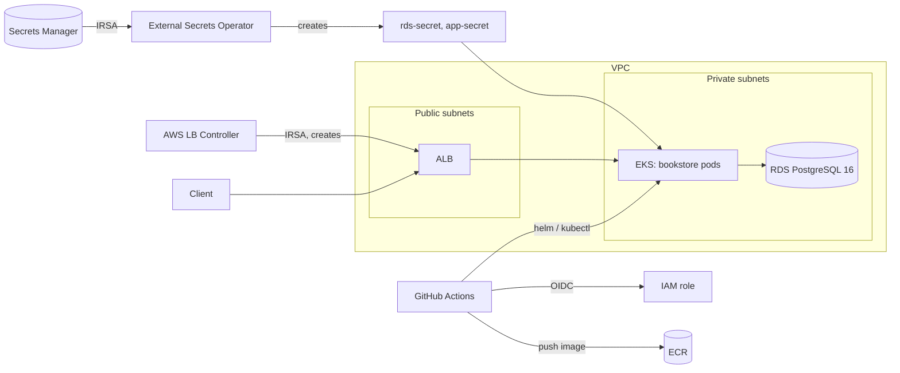

# Book Store Platform

A NestJS book store (register, browse, cart, order, pay) deployed to AWS EKS with Terraform, External Secrets Operator, the AWS Load Balancer Controller and a GitHub Actions pipeline.

The application is intentionally small. It exists to give the platform something realistic to run: a database-backed API with a health endpoint, Prometheus metrics, structured logs, tracing hooks and a load test. The focus of the project is the infrastructure and delivery pipeline around it.

## What this demonstrates

- **Infrastructure as code:** modular Terraform (VPC, EKS, RDS, ECR, IAM, Secrets Manager) with S3 remote state and lockfile locking.
- **Keyless CI/CD:** GitHub Actions authenticates to AWS with OIDC, so there are no static AWS keys.
- **Secrets without Git:** values live in AWS Secrets Manager and are synced into the cluster by External Secrets Operator using IRSA.
- **Managed ingress:** the AWS Load Balancer Controller creates an internet-facing ALB from a Kubernetes Ingress.
- **Observability:** metrics (Prometheus), logs (Loki), traces (OpenTelemetry to Jaeger) and Grafana dashboards, built and tested locally.
- **Rebuildable environment:** the pipeline installs the cluster controllers itself, so a destroyed environment can be recreated with `terraform apply` and one workflow run.

## Screenshots

See [screenshots/](screenshots) for the pipeline, Grafana, Jaeger and cluster screenshots.

## Architecture



| Layer | Owner | Notes |
|---|---|---|
| VPC, EKS, RDS, ECR, IAM, Secrets Manager | Terraform | `infrastructure/` |
| ESO and LB Controller installs | Pipeline (Helm) | Values in `helm/` |
| ClusterSecretStore, ExternalSecrets | Pipeline (kubectl) | `k8s/external-secrets/` |
| Deployment, Service, Ingress, ConfigMap | Pipeline (kubectl) | `k8s/app/` |
| ALB | Load Balancer Controller | Created from the Ingress, not by Terraform |

## Repository layout

```
infrastructure/        Terraform root and modules (vpc, eks, rds, ecr, iam, secrets)
helm/                  Values for External Secrets Operator and the LB Controller
k8s/app/               Deployment, Service, Ingress, ConfigMap
k8s/external-secrets/  ClusterSecretStore and ExternalSecrets
.github/workflows/     CI/CD pipeline
src/, prisma/          NestJS application and database schema
load-test/             k6 scenario
```

## CI/CD pipeline

Defined in `.github/workflows/ci.yaml`. It runs on pushes to `main` and can also be started manually from the Actions tab.

1. **Test:** typecheck, lint and unit tests (pull requests run only this job).
2. **Build:** build the image, scan it with Trivy, push to ECR tagged with the commit SHA.
3. **Deploy:**
   - Configure kubectl for the cluster and look up the VPC ID.
   - Install External Secrets Operator and the AWS Load Balancer Controller with `helm upgrade --install` (idempotent).
   - Apply the ExternalSecrets and wait until the Kubernetes secrets are synced.
   - Apply the app manifests with the new image and wait for the rollout.

GitHub repository secrets required: `AWS_ROLE_ARN`, `AWS_REGION`, `EKS_CLUSTER_NAME`, `ECR_REPOSITORY_URL` (all available from `terraform output`).

## Running it on AWS

Prerequisites: AWS credentials, Terraform >= 1.6, kubectl, Helm, and an S3 bucket for Terraform state (configured in `infrastructure/backend.tf`).

### Create the environment

1. Provide the sensitive Terraform variables, either as `TF_VAR_*` environment variables or in a gitignored `terraform.tfvars` (see `terraform.tfvars.example`): `db_username`, `db_password` (16+ characters), `db_name`, `jwt_secret`.
2. Apply the infrastructure:
   ```bash
   cd infrastructure
   terraform apply
   ```
3. Run the pipeline: push to `main`, or use Actions -> CI/CD -> Run workflow.
4. Get the ALB address and check the app:
   ```bash
   kubectl get ingress
   curl http://<alb-address>/health
   ```

Terraform is run locally rather than from the pipeline, because it manages the IAM role the pipeline itself assumes.

### Tear it down (to stop costs)

The ALB is created by the Load Balancer Controller, so Terraform does not know about it. Delete the Ingress first and wait for the ALB to disappear, otherwise it blocks VPC deletion:

```bash
kubectl delete -f k8s/app/ingress.yaml
cd infrastructure
terraform destroy
```

Pushes made while the cluster is destroyed will fail at the deploy job. Recreate the infrastructure first, then rerun the workflow.

## Running locally

Prerequisites: Node.js 20+ and Docker.

```bash
npm install
cp .env.example .env
npx prisma generate
docker-compose up -d postgres
npx prisma migrate dev --name init
npm run prisma:seed
npm run start:dev
```

- API: `http://localhost:3000`
- Swagger docs: `http://localhost:3000/api/docs`
- Health: `http://localhost:3000/health`
- Metrics: `http://localhost:3000/metrics`

The seed creates an admin user (`admin@bookstore.local`) and a handful of books. The seed password is for local development only: change it before exposing any shared deployment.

Run the whole stack in Docker with `docker-compose up --build`.

### Try the flow

```bash
# Register
curl -X POST http://localhost:3000/auth/register \
  -H "Content-Type: application/json" \
  -d '{"email":"reader@example.com","password":"S3curePass!","name":"Ada"}'

# Browse books
curl http://localhost:3000/books

# Add to cart (use the accessToken from register/login)
curl -X POST http://localhost:3000/cart/items \
  -H "Content-Type: application/json" \
  -H "Authorization: Bearer <token>" \
  -d '{"bookId":"<a book id from /books>","quantity":1}'

# Checkout
curl -X POST http://localhost:3000/orders -H "Authorization: Bearer <token>"
```

## Load testing

```bash
k6 run -e BASE_URL=http://<alb-address> load-test/scenario.js
```

Each virtual user registers, browses, adds books to the cart and checks out. Seeded stock is small, so a long run will start returning 400 errors for out-of-stock items. Raise book stock through the admin API before a run if you want clean results. See `load-test/README.md` for tuning options.

## Application stack

- **NestJS** (TypeScript), a modular monolith with one module per domain (Users, Books, Cart, Orders, Payments, Notifications)
- **PostgreSQL + Prisma**, schema in `prisma/schema.prisma`
- **JWT auth** (Passport), access tokens only
- **nestjs-pino** for structured JSON logs
- **Prometheus** `/metrics` endpoint with two business metrics (`orders_total`, `payment_duration_seconds`)
- **Terminus** `/health` endpoint with a database check
- **OpenTelemetry** tracing, exporting to the endpoint set in `OTEL_EXPORTER_OTLP_ENDPOINT`
- **Swagger** API docs at `/api/docs`

Design choices: Orders is the orchestrator for checkout (stock, order and cart clear in one transaction, payment afterwards so a failed payment never loses an order). Payments is a mock with configurable latency and failure rate, and Notifications are written synchronously for now.

## Observability

The app emits all three signals, and a full observability stack has been built and tested locally:

| Signal | Source in the app | Backend |
|---|---|---|
| Metrics | `/metrics` endpoint, including `orders_total` and `payment_duration_seconds` | Prometheus |
| Logs | Structured JSON logs (nestjs-pino) | Loki |
| Traces | OpenTelemetry spans around checkout steps (cart, stock, order, payment, notification) | Jaeger |

Grafana provides dashboards on top of Prometheus, Loki and Jaeger. This stack is not deployed to the EKS environment yet (see the roadmap). In the cluster, the app's `OTEL_EXPORTER_OTLP_ENDPOINT` currently points at a Jaeger service that does not exist there, so trace export fails quietly until the stack is deployed.

## Known limitations

These are deliberate trade-offs for a low-cost demo environment.

- Single replica, single NAT gateway and single-AZ RDS.
- The Kubernetes cluster API endpoint is public.
- Traffic is HTTP only. HTTPS needs a domain and an ACM certificate.
- Prisma migrations and the seed run on container start, which is not safe with multiple replicas.
- The Trivy scan reports findings but does not fail the build.
- The observability stack (Prometheus, Grafana, Loki, Jaeger) runs locally but is not deployed to the EKS environment yet.
- Terraform is run manually, not from the pipeline.

## Roadmap

1. Deploy the observability stack (Prometheus, Grafana, Loki, Jaeger) to EKS through the pipeline, and add alert rules on the existing metrics.
2. Harden the Deployment: readiness and liveness probes, resource requests and limits, non-root container.
3. Make the vulnerability scan blocking and pin third-party actions to commit SHAs.
4. HTTPS with a custom domain and ACM.
5. Move migrations into a separate Kubernetes Job and run more than one replica.
6. Run Terraform from the pipeline with a dedicated, persistent deployment role.