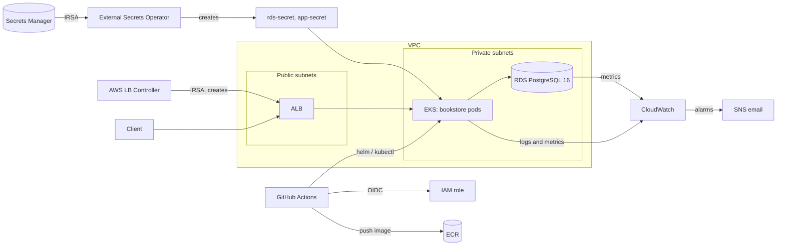

# Book Store Platform: EKS, Terraform & CI/CD


A NestJS book store (register, browse, cart, order, pay) deployed to AWS EKS with Terraform, External Secrets Operator, the AWS Load Balancer Controller and a GitHub Actions pipeline.

The application is intentionally small. It exists to give the platform something realistic to run: a database-backed API with a health endpoint, Prometheus metrics, structured logs, tracing and a load test. The focus of the project is the infrastructure and delivery pipeline around it.

## Contents

- [Book Store Platform: EKS, Terraform \& CI/CD](#book-store-platform-eks-terraform--cicd)
  - [Contents](#contents)
  - [What this demonstrates](#what-this-demonstrates)
  - [Technology stack](#technology-stack)
  - [Screenshots](#screenshots)
  - [Architecture](#architecture)
  - [Repository structure](#repository-structure)
  - [AWS infrastructure](#aws-infrastructure)
    - [Networking](#networking)
    - [Amazon EKS](#amazon-eks)
    - [Amazon RDS](#amazon-rds)
    - [Secrets management](#secrets-management)
    - [Ingress and load balancing](#ingress-and-load-balancing)
    - [Container registry](#container-registry)
    - [Monitoring and alerts](#monitoring-and-alerts)
  - [Infrastructure as Code](#infrastructure-as-code)
    - [Terraform and pipeline ownership](#terraform-and-pipeline-ownership)
  - [CI/CD pipeline](#cicd-pipeline)
    - [Keyless authentication with GitHub OIDC](#keyless-authentication-with-github-oidc)
  - [Running it on AWS](#running-it-on-aws)
    - [Create the environment](#create-the-environment)
    - [Tear it down (to stop costs)](#tear-it-down-to-stop-costs)
  - [Deployment verification](#deployment-verification)
  - [Observability and health checks](#observability-and-health-checks)
  - [Running locally](#running-locally)
    - [Try the flow](#try-the-flow)
  - [Load testing](#load-testing)
  - [Application stack](#application-stack)
  - [Challenges and lessons learned](#challenges-and-lessons-learned)
    - [Kubernetes secrets were lost on every cluster rebuild](#kubernetes-secrets-were-lost-on-every-cluster-rebuild)
    - [Pods stuck in Pending on ready nodes](#pods-stuck-in-pending-on-ready-nodes)
    - [Docker build took over 12 minutes](#docker-build-took-over-12-minutes)
    - [Container crashed on start: Prisma could not find OpenSSL](#container-crashed-on-start-prisma-could-not-find-openssl)
  - [Known limitations](#known-limitations)
  - [Roadmap](#roadmap)
  - [Skills demonstrated](#skills-demonstrated)

## What this demonstrates

- **Infrastructure as code:** modular Terraform (VPC, EKS, RDS, ECR, IAM, Secrets Manager, CloudWatch) with S3 remote state and lockfile locking.
- **Keyless CI/CD:** GitHub Actions authenticates to AWS with OIDC, so there are no static AWS keys.
- **Secrets without Git:** values live in AWS Secrets Manager and are synced into the cluster by External Secrets Operator using IRSA.
- **Managed ingress:** the AWS Load Balancer Controller creates an internet-facing ALB from a Kubernetes Ingress.
- **Rebuildable environment:** the pipeline installs the cluster controllers itself, so a destroyed environment can be recreated with `terraform apply` and one workflow run.
- **Observability:** AWS-native monitoring on EKS (CloudWatch Container Insights, log groups and alarms), plus a full open-source stack (Prometheus, Grafana, Loki, Jaeger with OpenTelemetry) built and tested locally.
- **Load testing:** a k6 scenario exercises the real user journey through the ALB.

## Technology stack

| Technology | Purpose |
|---|---|
| AWS EKS | Kubernetes control plane and managed node group |
| Amazon ECR | Docker image registry (immutable tags, scan on push) |
| Amazon RDS (PostgreSQL 16) | Application database in private subnets |
| Application Load Balancer | Public entry point, created by the AWS Load Balancer Controller |
| AWS Secrets Manager | Database credentials and JWT secret |
| External Secrets Operator | Syncs Secrets Manager values into Kubernetes Secrets |
| AWS IAM (OIDC and IRSA) | Keyless pipeline access and per-controller workload identity |
| Amazon CloudWatch | Container Insights, centralised logs, metrics and alarms on EKS |
| Amazon SNS | Email notifications for CloudWatch alarms |
| Terraform | Infrastructure as Code |
| Helm | Installs External Secrets Operator and the Load Balancer Controller |
| Docker | Containerisation |
| GitHub Actions | CI/CD |
| NestJS, Prisma | Application and database access |
| k6 | Load testing |
| Prometheus, Grafana, Loki, Jaeger | Local observability stack |

## Screenshots

See [screenshots](/screenshots) for the pipeline, Grafana, Jaeger and cluster screenshots.

## Architecture



| Layer | Owner | Notes |
|---|---|---|
| VPC, EKS, RDS, ECR, IAM, Secrets Manager | Terraform | `infrastructure/` |
| CloudWatch add-on, log groups, alarms, SNS | Terraform | `modules/eks/` and `infrastructure/observability.tf` |
| ESO and LB Controller installs | Pipeline (Helm) | Values in `helm/` |
| ClusterSecretStore, ExternalSecrets | Pipeline (kubectl) | `k8s/external-secrets/` |
| Deployment, Service, Ingress, ConfigMap | Pipeline (kubectl) | `k8s/app/` |
| ALB | Load Balancer Controller | Created from the Ingress, not by Terraform |

## Repository structure

```
bookstore-devops-platform/
├── .github/workflows/
│   └── ci.yaml                 # CI/CD pipeline
├── infrastructure/
│   ├── backend.tf              # S3 remote state with lockfile
│   ├── main.tf                 # Module wiring
│   ├── observability.tf        # SNS topic, email subscription, CloudWatch alarms
│   ├── providers.tf
│   ├── variables.tf
│   ├── outputs.tf
│   └── modules/
│       ├── vpc/                # VPC, subnets, IGW, NAT, routes
│       ├── eks/                # Cluster, node group, add-ons (incl. CloudWatch), OIDC provider
│       ├── rds/                # PostgreSQL instance, subnet group, security group
│       ├── ecr/                # Image repository and lifecycle policy
│       ├── iam/                # GitHub OIDC role, IRSA roles for ESO and LB Controller
│       └── secrets/            # Secrets Manager secrets
├── helm/
│   ├── external-secrets/       # ESO values
│   └── aws-load-balancer-controller/
├── k8s/
│   ├── app/                    # Deployment, Service, Ingress, ConfigMap
│   └── external-secrets/       # ClusterSecretStore and ExternalSecrets
├── src/, prisma/               # NestJS application and database schema
├── load-test/                  # k6 scenario
├── Dockerfile
└── docker-compose.yml          # Local app + PostgreSQL
```

## AWS infrastructure

### Networking
- A custom VPC across two Availability Zones with public subnets (for the ALB) and private subnets (for nodes and RDS).
- An Internet Gateway for public subnets and a single NAT gateway for outbound access from private subnets.
- Subnets are tagged so the Load Balancer Controller can place the ALB.

### Amazon EKS
- Managed control plane and managed node group in private subnets, with the VPC CNI, CoreDNS and kube-proxy add-ons.
- An IAM OIDC provider for the cluster, which enables IRSA (IAM roles for service accounts).
- Cluster access for the pipeline uses EKS access entries.

### Amazon RDS
- PostgreSQL 16 in private subnets, not publicly accessible, with encrypted storage.
- The database security group accepts connections only from the cluster.

### Secrets management
- Database credentials and the JWT secret are stored in AWS Secrets Manager.
- External Secrets Operator reads them using an IRSA role limited to the two bookstore secrets, and creates the `rds-secret` (including a ready-made `DATABASE_URL`) and `app-secret` Kubernetes Secrets.
- No secret is committed to Git or baked into the image.

### Ingress and load balancing
- The Ingress uses the `alb` class. The Load Balancer Controller creates an internet-facing ALB and registers pod IPs as targets.
- The target group health check uses `/health`.

### Container registry
- ECR with immutable tags, scan on push, and a lifecycle policy that keeps the newest 10 images. Images are tagged with the Git commit SHA.

### Monitoring and alerts
- The `amazon-cloudwatch-observability` EKS add-on runs a Fluent Bit agent and a CloudWatch agent on every node. They ship pod logs and cluster metrics (Container Insights) to CloudWatch.
- The four Container Insights log groups are created by Terraform with 7-day retention, so they are removed on `terraform destroy` and cannot accumulate cost.
- Alarms for RDS CPU and node CPU notify an SNS topic with an email subscription.
- The agents get their permissions from the AWS-managed `CloudWatchAgentServerPolicy` on the node role.

## Infrastructure as Code

Terraform manages the VPC, EKS cluster and node group, RDS, ECR, Secrets Manager secrets, the CloudWatch add-on, log groups, alarms and SNS topic, and all IAM (the GitHub OIDC role, the External Secrets role and the Load Balancer Controller role). State is stored in S3 with lockfile locking and encryption.

Typical workflow:

```bash
cd infrastructure
terraform fmt
terraform validate
terraform plan
terraform apply
```

### Terraform and pipeline ownership

Terraform and the pipeline each own a clear set of resources, so they never fight over the same objects.

| Owner | Responsibility |
|---|---|
| Terraform | AWS infrastructure, IAM roles, Secrets Manager secrets, CloudWatch resources |
| GitHub Actions | Controller installs (Helm), Kubernetes manifests, application image and releases |

Terraform is run locally rather than from the pipeline, because it manages the IAM role the pipeline itself assumes.

## CI/CD pipeline

Defined in `.github/workflows/ci.yaml`. It runs on pushes to `main` and can also be started manually from the Actions tab.

1. **Test:** typecheck, lint and unit tests (pull requests run only this job).
2. **Build:** authenticate to AWS with OIDC, build the image, scan it with Trivy, push to ECR tagged with the commit SHA.
3. **Deploy:**
   - Configure kubectl for the cluster and look up the VPC ID.
   - Install External Secrets Operator and the AWS Load Balancer Controller with `helm upgrade --install` (idempotent).
   - Apply the ExternalSecrets and wait until the Kubernetes secrets are synced.
   - Apply the app manifests with the new image and wait for the rollout.

Tagging with the commit SHA links every running deployment back to the exact source revision that produced it.

### Keyless authentication with GitHub OIDC

Instead of storing AWS access keys as GitHub secrets, the workflow exchanges a short-lived GitHub identity token for temporary AWS credentials. The role is restricted to this repository and the `main` branch, and limited to what the pipeline needs: pushing images to ECR and accessing the cluster.

GitHub repository secrets required: `AWS_ROLE_ARN`, `AWS_REGION`, `EKS_CLUSTER_NAME`, `ECR_REPOSITORY_URL` (all available from `terraform output`).

## Running it on AWS

Prerequisites: AWS credentials, Terraform >= 1.6, kubectl, Helm, and an S3 bucket for Terraform state (configured in `infrastructure/backend.tf`).

### Create the environment

1. Provide the Terraform variables, either as `TF_VAR_*` environment variables or in a gitignored `terraform.tfvars` (see `terraform.tfvars.example`): `db_username`, `db_password` (16+ characters), `db_name`, `jwt_secret`, and `alert_email` (where CloudWatch alarms are sent).
2. Apply the infrastructure:
   ```bash
   cd infrastructure
   terraform apply
   ```
   AWS emails a subscription confirmation to `alert_email`. Click the link, or no alarm notifications will arrive.
3. Run the pipeline: push to `main`, or use Actions -> CI/CD -> Run workflow.
4. Get the ALB address and check the app:
   ```bash
   kubectl get ingress
   curl http://<alb-address>/health
   ```

### Tear it down (to stop costs)

The ALB is created by the Load Balancer Controller, so Terraform does not know about it. Delete the Ingress first and wait for the ALB to disappear, otherwise it blocks VPC deletion:

```bash
kubectl delete -f k8s/app/ingress.yaml
cd infrastructure
terraform destroy
```

Pushes made while the cluster is destroyed will fail at the deploy job. Recreate the infrastructure first, then rerun the workflow.

## Deployment verification

Check the application through the ALB:

```bash
curl http://<alb-address>/health
```

Expected response:

```json
{"status":"ok","info":{"database":{"status":"up"}},"error":{},"details":{"database":{"status":"up"}}}
```

Check the cluster:

```bash
kubectl get pods
kubectl get ingress
kubectl get externalsecret          # both should show SecretSynced
helm list -A                        # external-secrets and aws-load-balancer-controller
kubectl get pods -n amazon-cloudwatch   # CloudWatch agents running
```

Check that logs are reaching CloudWatch:

```bash
aws logs tail /aws/containerinsights/bookstore-eks/application --follow --region eu-north-1
```

## Observability and health checks

`/health` is used by the ALB target group health check and for manual verification. It includes a database connectivity check, so a healthy response confirms the app can reach RDS.

The app emits three observability signals. What collects them depends on the environment:

| Signal | Source in the app | On EKS | Local stack |
|---|---|---|---|
| Logs | Structured JSON on stdout (nestjs-pino) | CloudWatch Logs via Fluent Bit | Loki |
| Infrastructure metrics | Kubelet, RDS | CloudWatch Container Insights and `AWS/RDS` metrics | Prometheus |
| Application metrics | `/metrics` endpoint (`orders_total`, `payment_duration_seconds`) | Not collected | Prometheus |
| Traces | OpenTelemetry spans around checkout steps (cart, stock, order, payment, notification) | Not collected | Jaeger |

Grafana provides dashboards on top of Prometheus, Loki and Jaeger in the local stack.

**Where to look in CloudWatch** (region eu-north-1):

- Logs: Logs -> Log groups -> `/aws/containerinsights/bookstore-eks/application`, or Logs Insights for queries.
- Cluster dashboard: Insights -> Container Insights -> Performance monitoring -> EKS Clusters -> `bookstore-eks`.
- Alarms: Alarms -> All alarms (`bookstore-rds-cpu-high`, `bookstore-node-cpu-high`).

Container Insights data can take 5 to 10 minutes to appear after the add-on starts.

## Running locally

Prerequisites: Node.js 20+ and Docker.

```bash
npm install
cp .env.example .env
npx prisma generate
docker-compose up -d postgres
npx prisma migrate dev --name init
npm run prisma:seed
npm run start:dev
```

- API: `http://localhost:3000`
- Swagger docs: `http://localhost:3000/api/docs`
- Health: `http://localhost:3000/health`
- Metrics: `http://localhost:3000/metrics`

The seed creates an admin user (`admin@bookstore.local`) and a handful of books. The seed password is for local development only: change it before exposing any shared deployment.

Run the whole stack in Docker with `docker-compose up --build`.

### Try the flow

```bash
# Register
curl -X POST http://localhost:3000/auth/register \
  -H "Content-Type: application/json" \
  -d '{"email":"reader@example.com","password":"S3curePass!","name":"Ada"}'

# Browse books
curl http://localhost:3000/books

# Add to cart (use the accessToken from register/login)
curl -X POST http://localhost:3000/cart/items \
  -H "Content-Type: application/json" \
  -H "Authorization: Bearer <token>" \
  -d '{"bookId":"<a book id from /books>","quantity":1}'

# Checkout
curl -X POST http://localhost:3000/orders -H "Authorization: Bearer <token>"
```

## Load testing

```bash
k6 run -e BASE_URL=http://<alb-address> load-test/scenario.js
```

Each virtual user registers, browses, adds books to the cart and checks out. Seeded stock is small, so a long run will start returning 400 errors for out-of-stock items. Raise book stock through the admin API before a run if you want clean results. See `load-test/README.md` for tuning options.

## Application stack

- **NestJS** (TypeScript), a modular monolith with one module per domain (Users, Books, Cart, Orders, Payments, Notifications)
- **PostgreSQL + Prisma**, schema in `prisma/schema.prisma`
- **JWT auth** (Passport), access tokens only
- **nestjs-pino** for structured JSON logs
- **Prometheus** `/metrics` endpoint with two business metrics (`orders_total`, `payment_duration_seconds`)
- **Terminus** `/health` endpoint with a database check
- **OpenTelemetry** tracing, exporting to the endpoint set in `OTEL_EXPORTER_OTLP_ENDPOINT`
- **Swagger** API docs at `/api/docs`

Design choices: Orders is the orchestrator for checkout (stock, order and cart clear in one transaction, payment afterwards so a failed payment never loses an order). Payments is a mock with configurable latency and failure rate, and Notifications are written synchronously for now.

## Challenges and lessons learned

### Kubernetes secrets were lost on every cluster rebuild
**Problem:** I destroy and recreate the EKS cluster regularly to save cost, which wiped the manually created Kubernetes Secrets. Every rebuild needed hand-made secrets before the app could start.
**Fix:** The database credentials already lived in AWS Secrets Manager, so I added External Secrets Operator. It reads them through an IRSA role scoped to the bookstore secrets and creates the Kubernetes Secrets itself. The pipeline installs it and applies the `ClusterSecretStore` and `ExternalSecret` manifests.
**Result:** A rebuild is now `terraform apply` plus one workflow run, with no manual steps and no secrets in Git.

### Pods stuck in Pending on ready nodes
**Problem:** After deploying to EKS, pods stayed `Pending` even though the nodes were `Ready`. `kubectl describe pod` showed `Too many pods`.
**Cause:** I had moved the node group to `t3.micro` to save cost. The AWS VPC CNI gives each pod an ENI IP address, and a `t3.micro` allows only 4 pods. CoreDNS, kube-proxy and the CNI use most of those slots.
**Fix:** I moved the node group to a larger instance type in Terraform and re-applied. `t3.small` (11 pods) was enough at first, but the CloudWatch add-on, External Secrets Operator and the Load Balancer Controller together need around 13 pods, so the node group now uses `t3.medium` (17 pods).
**Lesson:** CPU and memory limits aren't the only scheduling limit. AWS ENI and IP limits cap pod density separately, and every add-on spends from the same budget.

### Docker build took over 12 minutes
**Problem:** Local image builds were taking 12+ minutes, and the build context alone was 377 MB.
**Cause:** With no `.dockerignore`, Docker sent `node_modules`, `dist`, `.git` and `load-test` to the daemon on every build.
**Fix:** I added a `.dockerignore` excluding them.
**Result:** The context dropped to 3.5 KB and builds fell to under a minute. Layer caching also started working, so source-only changes skip `npm ci`.

### Container crashed on start: Prisma could not find OpenSSL
**Problem:** The pod exited with code 1 straight after starting, with nothing useful in the first logs.
**Diagnosis:** `kubectl describe pod` and its Events showed `Prisma failed to detect the libssl/openssl version`. The Prisma engine needs OpenSSL at runtime, and `node:22-alpine` doesn't include it.
**Fix:** I added `RUN apk add --no-cache openssl` to the final image stage.
**Lesson:** Minimal base images leave out runtime dependencies you would normally take for granted.

## Known limitations

These are deliberate trade-offs for a low-cost demo environment.

- Single replica, single NAT gateway and single-AZ RDS.
- The Kubernetes cluster API endpoint is public.
- Traffic is HTTP only. HTTPS needs a domain and an ACM certificate.
- Prisma migrations and the seed run on container start, which is not safe with multiple replicas.
- The Trivy scan reports findings but does not fail the build.
- On EKS, observability is CloudWatch only: container logs, cluster and database metrics, and two alarms. Application metrics (`/metrics`) and traces are only available in the local Prometheus, Grafana, Loki and Jaeger stack.
- There is no ALB 5xx alarm yet, because the ALB is created by the controller and is not known to Terraform.
- Terraform is run manually, not from the pipeline.

## Roadmap

1. Collect application metrics and traces on EKS (CloudWatch agent Prometheus scraping, or an OpenTelemetry collector to X-Ray), and add an ALB 5xx alarm.
2. Harden the Deployment: readiness and liveness probes, resource requests and limits, non-root container.
3. Make the vulnerability scan blocking and pin third-party actions to commit SHAs.
4. HTTPS with a custom domain and ACM.
5. Move migrations into a separate Kubernetes Job and run more than one replica.
6. Run Terraform from the pipeline with a dedicated, persistent deployment role.

## Skills demonstrated

- **Cloud:** AWS networking, EKS, RDS, ALB, ECR, IAM (OIDC and IRSA), Secrets Manager
- **Infrastructure as Code:** modular Terraform, remote state with locking
- **Kubernetes:** Helm, External Secrets Operator, AWS Load Balancer Controller, Ingress
- **CI/CD:** GitHub Actions, OIDC federation, SHA image tagging, idempotent bootstrap of cluster controllers
- **Observability:** CloudWatch Container Insights, log groups and alarms with SNS; Prometheus, Grafana, Loki, Jaeger and OpenTelemetry locally
- **Operations:** troubleshooting, health checks, load testing with k6, cost-aware teardown and rebuild